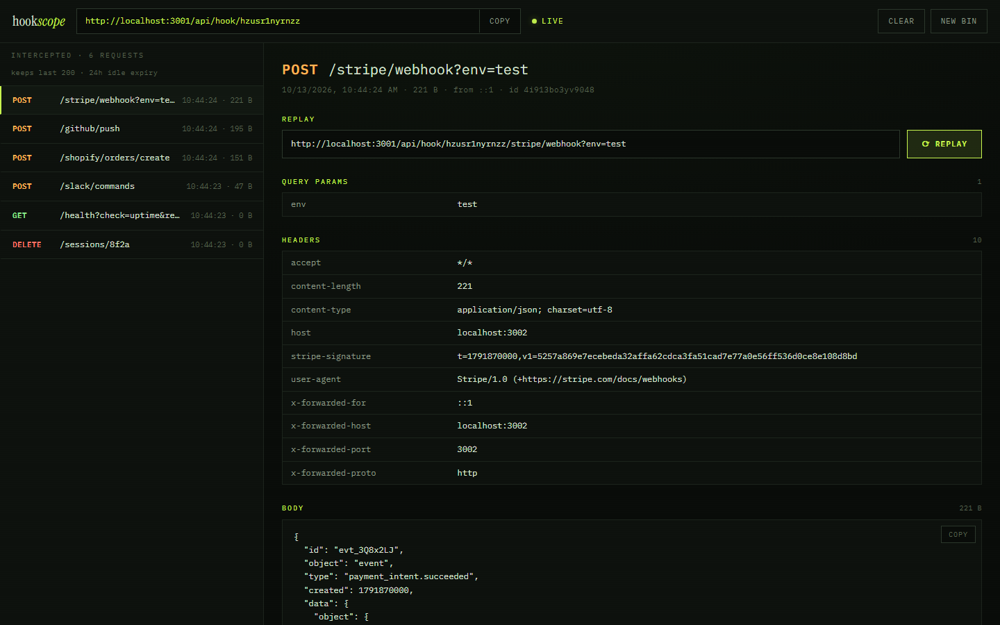

<div align="center">

# hook*scope*

**Catch every webhook. Inspect it. Replay it.**

A self-hostable webhook inspector, like a mini RequestBin. Open a bin, get a
temporary URL, and every HTTP request that hits it shows up in your browser
the moment it lands. Resend any of them anywhere with one click.



</div>

## Features

- **Instant bins.** One click gives you a URL. No sign-up, no config.
- **Accepts anything.** Every method (`GET` `POST` `PUT` `PATCH` `DELETE` `HEAD` `OPTIONS`), any sub-path (`/api/hook/<bin>/github/push`), any payload. Binary bodies are detected and shown as base64.
- **Live.** Requests stream to the browser over Server-Sent Events, with no polling and no refresh.
- **Full detail.** Method, path, query params, headers, pretty-printed JSON body, size, source IP, timestamp.
- **Replay.** Resend a captured request to any URL, server-side (so CORS doesn't get in the way), and see the target's status, timing and response.
- **Copy as curl.** Turns any capture into a runnable, safely quoted `curl` command.
- **CORS-friendly.** You can hit a bin from browser `fetch()` calls, not just servers.
- **Safe to host publicly.** Replay blocks private and internal network addresses (SSRF protection). Bins, captures and replays are rate-limited, bins expire on their own, and platform-internal headers are stripped.

## Quick start

```bash
npm install
npm run dev
```

Open http://localhost:3000, click **open a new bin**, then send it something:

```bash
curl -X POST http://localhost:3000/api/hook/<your-bin-id>/orders \
  -H "content-type: application/json" \
  -d '{"event":"order.created","amount":4900}'
```

Locally, no database is needed: bins live in memory and disappear on restart.

> **Webhooks from real providers** (Stripe, GitHub, Shopify…) need a public URL.
> Either deploy it (below), or tunnel your local server with
> `ngrok http 3000` / `cloudflared tunnel --url http://localhost:3000`.

## Deploy to Vercel

hookscope runs on Vercel's free Hobby plan. It needs a Redis database, because
serverless functions don't share memory: without Redis, a webhook captured by
one instance would never reach a browser connected to another.

1. **Push this repo to GitHub** and import it at [vercel.com/new](https://vercel.com/new). The defaults are fine, since Vercel detects Next.js.
2. **Add Redis.** In the project, open the **Storage** tab, choose **Upstash for Redis** from the Marketplace (it has a free tier), and connect it to the project. The integration adds the connection string as `REDIS_URL` or `KV_URL` (hookscope reads either).
3. **Redeploy** so the new environment variable takes effect (Deployments → ⋯ → Redeploy).

That's it. Your bin URLs look like `https://<your-app>.vercel.app/api/hook/<bin-id>`.

**Notes:**

- If you forget step 2, the app doesn't silently misbehave. Opening a bin shows an error explaining that `REDIS_URL` is missing.
- Keep **Fluid compute** on (the default for new projects). Each live stream stays open for about 5 minutes, then the browser reconnects automatically and catches up on anything it missed.
- **Deployment Protection** on preview deployments returns 401 to external webhook senders. Use your production domain for real webhooks.
- Any Redis provider works (Redis Cloud, Railway, self-hosted). Set `REDIS_URL=redis://…` or `rediss://…` for TLS.

### Self-hosting elsewhere

A single long-running server (a VPS, Railway, Fly, Docker) works with no Redis at all:

```bash
npm run build
npm start          # PORT=8080 npm start to change the port
```

Add `REDIS_URL` if you run more than one instance, or want bins to survive restarts.

## Configuration

Everything is optional. See [`.env.example`](.env.example) for the full list.

| Variable | Default | What it does |
| --- | --- | --- |
| `REDIS_URL` | none | Redis storage + pub/sub. Required on Vercel. |
| `BIN_TTL_HOURS` | `24` | Bins are deleted after this long idle. |
| `MAX_REQUESTS_PER_BIN` | `200` | Older captures are dropped beyond this. |
| `MAX_BODY_KB` | `256` | Larger bodies are truncated. |
| `RATE_LIMIT_CAPTURE_PER_MIN` | `120` | Per bin. |
| `RATE_LIMIT_REPLAY_PER_MIN` | `30` | Per client IP. |
| `RATE_LIMIT_BINS_PER_MIN` | `10` | Per client IP. |
| `ALLOW_PRIVATE_REPLAY` | dev: `true`, prod: `false` | Allow replaying to localhost/private IPs. |
| `NEXT_PUBLIC_SITE_URL` | auto on Vercel | Absolute URL for social-share cards. |

## API

| Endpoint | Purpose |
| --- | --- |
| `ANY /api/hook/:bin/*` | Capture a request. Returns `{ ok, binId, requestId }`. |
| `POST /api/bins` | Create a bin. Returns `{ id, createdAt }`. |
| `GET /api/bins/:bin/requests` | All captures, newest first. |
| `DELETE /api/bins/:bin/requests` | Clear a bin. |
| `GET /api/bins/:bin/stream` | SSE stream with `hello`, `request` and `cleared` events. |
| `POST /api/replay` | `{ binId, requestId, targetUrl }` → the target's response. |

## How it works

```
 sender ──▶ /api/hook/:bin ──▶ store.addRequest ──▶ LPUSH + PUBLISH (Redis)
                                                    or EventEmitter (memory)
                                                           │
 browser ◀── SSE ◀── /api/bins/:bin/stream ◀── SUBSCRIBE ◀─┘
```

Captures go into a per-bin list and are broadcast on a per-bin channel. Every
open live stream is subscribed to that channel and forwards events to its
browser. Whenever a stream (re)connects, the browser also refetches the
backlog, so nothing that arrived during a reconnect is lost.

For a file-by-file walkthrough, see [explanation.md](explanation.md).

## Security model

- **Bin IDs are the access control.** They're 12 random characters (about 62 bits), so they can't practically be guessed, but anyone holding a bin URL can view it. Don't send production secrets to a public instance.
- **Replay can't reach internal networks.** Destinations are checked at connection time, so DNS-rebinding tricks are caught too. Blocked ranges: loopback, RFC 1918 private ranges, link-local (including cloud metadata `169.254.169.254`), CGNAT, IPv6 ULA/link-local, NAT64, multicast, reserved.
- **Abuse limits:** rate limits on bin creation, captures and replays; capped body size; capped requests per bin; automatic expiry.
- Bin pages are marked `noindex`, and standard security headers are set.

## Tech

[Next.js 16](https://nextjs.org) (App Router, route handlers, Turbopack) ·
React 19 · TypeScript · [node-redis](https://github.com/redis/node-redis) ·
[undici](https://github.com/nodejs/undici) · hand-written CSS (no framework) ·
IBM Plex Mono + Instrument Serif.

## License

[MIT](LICENSE)
